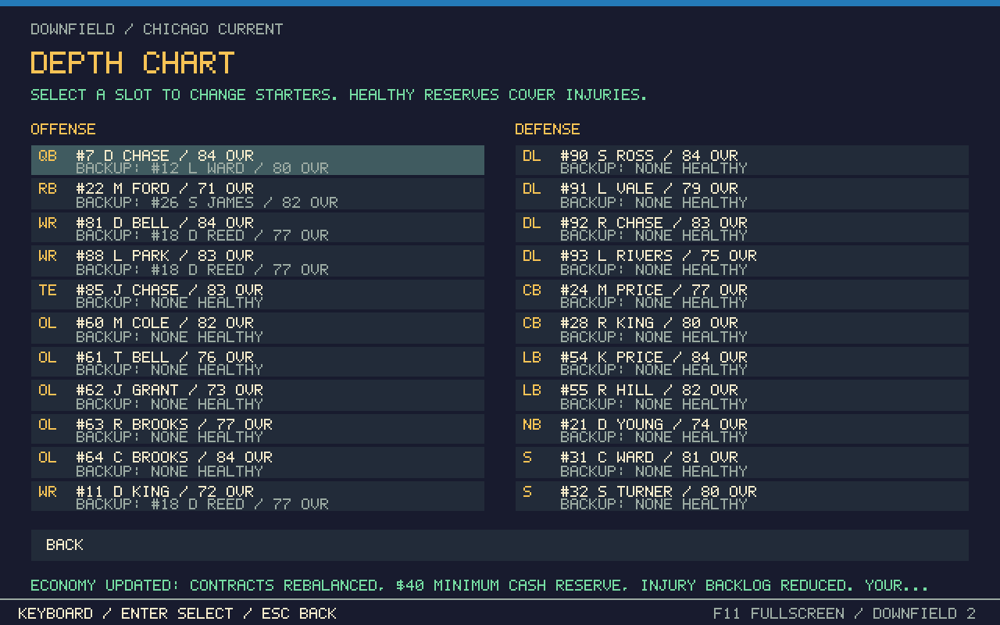
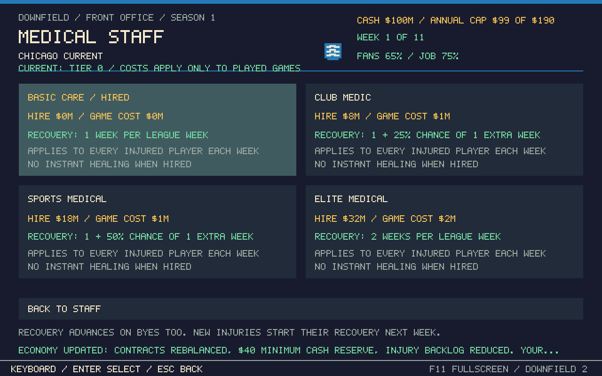
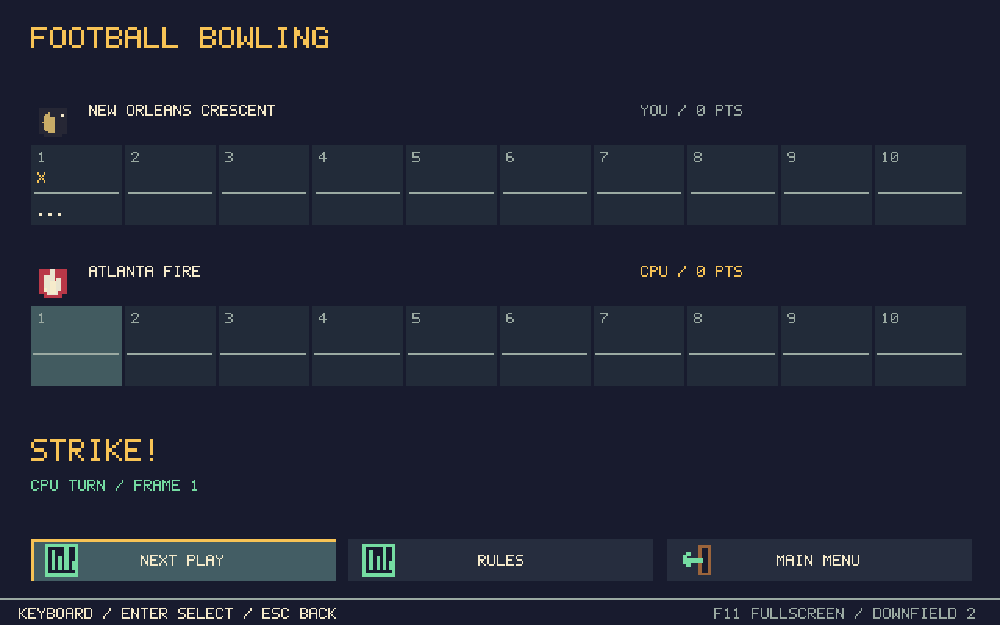
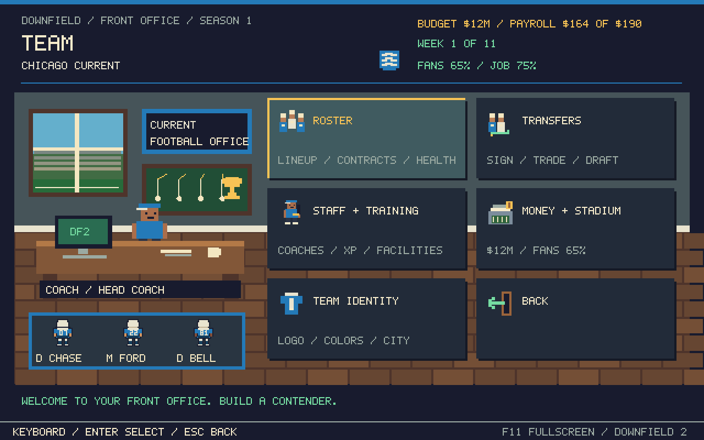
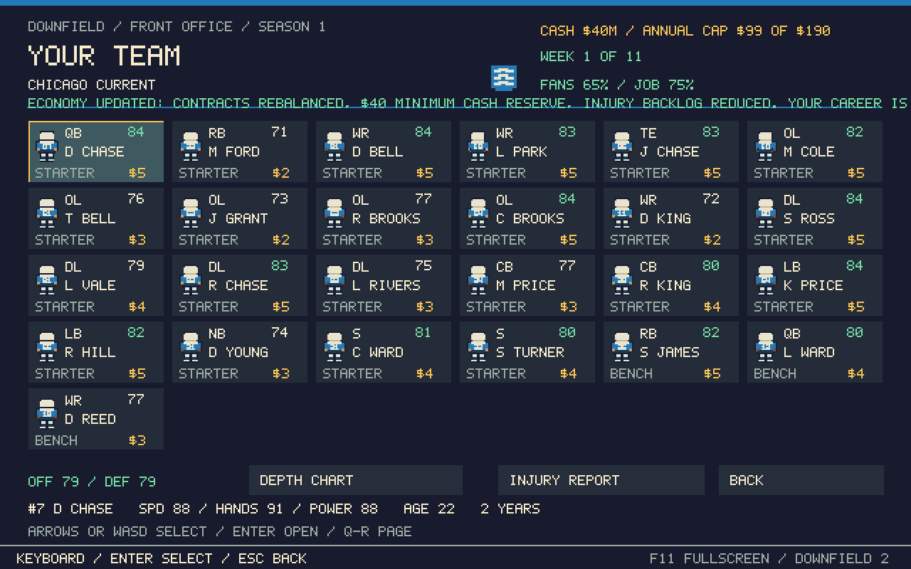
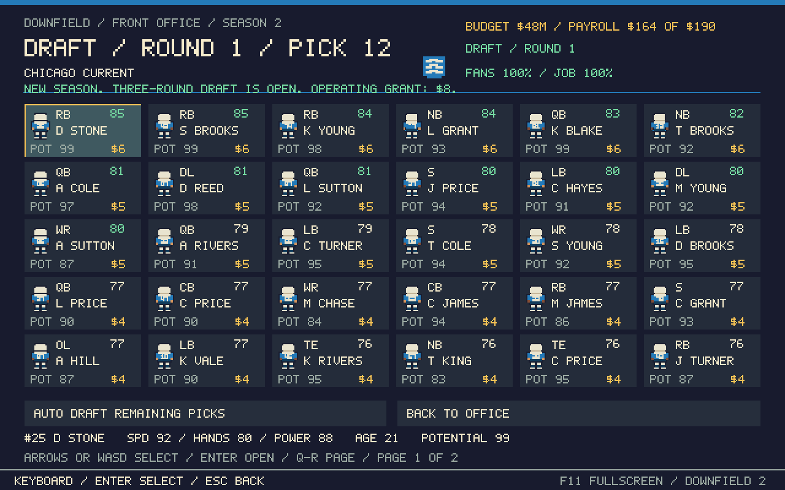

# Downfield 2

A little arcade football game I'm working on. I wanted quick games, Madden-style buttons, and a team you can build over a season. It's still a work in progress.

## Just want to play?

**[Download v2.4 - updated Windows installer](https://github.com/dstaggs-15/downfieldftbl/raw/refs/heads/main/play%20me/Install%20Downfield.exe)**

Open it and click **INSTALL GAME** to put Downfield 2 on your desktop. The installer includes the game and needs no extra downloads. You need **64-bit Windows 10/11** with Windows' .NET Framework. The installer is unsigned.

Or download the [Windows ZIP](https://github.com/dstaggs-15/downfieldftbl/raw/refs/heads/main/play%20me/Downfield-Windows.zip), extract it, and run the installer inside. You can also download the whole repo, open **play me**, and run **Downfield/Downfield.exe**. If Defender flags a file, keep it quarantined and report the affected-file path; the scan result here is not a Microsoft clearance.

There is also a [portable game EXE](https://github.com/dstaggs-15/downfieldftbl/raw/refs/heads/main/play%20me/Downfield/Downfield.exe) if you want the game without setup.

## New in this update

- **Depth chart:** Pause > Depth Chart during games, or Franchise > Team > Roster > Depth Chart. Compare starters, healthy backups, ratings and injuries. Select a position to change its starter; in-game substitutions take effect at the next snap.
- **Money and salary cap fixes:** rebalanced annual salaries leave room for backups. Every club gets broadcast income at home and away, with the same operating-cost rules. Bye/eliminated weeks no longer charge phantom game bills. Existing saves get a one-time contract rebalance, at least $40M cash, and shorter lingering injuries while keeping your career and roster.
- **Hire medical staff:** Team > Staff + Training > Medical Staff. Choose Basic, an $8M club medic, $18M sports medical, or $32M elite care. Better care heals players faster, with $0–$2M running costs per played game. You can downgrade for free.
- **Hard-mode injuries:** each player gets one serious-injury roll per game, at most two serious injuries per match. Normal hits cause 1–2 week absences; dangerous landings 2–3. Fitness reduces the risk. Big-hit animations remain.

- **Bowling** is on the main menu. Start at the 10 with two plays to score. First-play TD is a strike, second-play TD is a spare. Ten frames, normal bowling bonuses, and a perfect 300. Play the CPU or take turns with a friend on the same controller.
- The franchise office has **Team, League and Coach** sections now. Money and stadium prices are under Team. Signing, trading and the draft are together under Transfers.
- **48 plays**, with 24 new arcade calls: flea flickers, reverses, Philly Special, HB/WR passes, fake gives, screens and wildcat.
- Draw a play, name it, and **Save to Book**. Keep up to 40 custom calls, then select them from the playbook. Rename, edit or delete them under My Saved Plays. Route previews use the actual route logic.
- All your QBs hurt? Pick any healthy roster player to take the snaps. He keeps his own name and number, and non-QBs are much worse at throwing.
- **Aggressive catch meter:** hold Y while a forward pass is in the air, then release in the desired color. One press and one release; pressing again cannot retry. The green zone is smaller and the sweep is faster. You get **five uses per game**, shared across halves and drives; normal catches still work afterward. Green is 100%, yellow 75%, red 4%. Keyboard default is also Y; remapping works.
- Change keyboard and controller bindings in **Options > Controls**, or Pause > Controls. Conflicting controls swap. Movement and skill sticks can swap too.
- Trade across positions. The other club now checks value, age, potential, contracts, injuries, roster needs and both salary caps. Cash won't make up for a bad player offer.
- Catch reaches, aggressive catch leaps, fake throws, celebrations and sideline clapping. **Three timeouts per half** are shown on the scoreboard and called from Pause.

## Modes and team features

The first screen has **Exhibition**, **Franchise** and **Bowling**. The clubhouse uses shorter labels, icons and little pixel players.

- Name your coach and change his pixel appearance.
- Keep your coach record when you change teams.
- Follow past seasons and champions, and collect championship, MVP and OPOTY trophies.
- Call from 48 plays, including read option, jet sweep, toss, mesh and wheel routes.
- Create a play: pick a receiver, choose a route, then press Use Play. Save it or draw your own routes if you want.
- Nudge the left stick as you release a throw to lead your receiver a little.
- Hear stadium crowds, touchdown cheers, first-down applause, big-hit reactions and tackle sounds. Pause > Audio Mixer has the sound mixer.

Halftime now resets the field and possession. You receive to start the game; the opponent receives at its own 20 after halftime. Playoff games have their own scoreboard label and bowl art. Speed, hands and OVR make more of a difference, and receivers block once your QB crosses the line.

## What the game is

You play offense and try to put points on the board. Pick a run or pass, read what's open, and use your receivers' buttons to throw. The other team's drives are simulated. Quarters are one minute, so a game doesn't take long.

There are jukes, spins, jumps, trucks, dives, fumbles, interceptions and field goals. The defense changes coverages, disguises some of them and mixes in occasional two-man stunts. Bigger hits can knock someone down or cause an injury.

It's meant to be fun and arcadey.

## Build your team

The Clubhouse is your little pixel-art office. From there you can:

- Look through your roster and choose who starts.
- Sign players from 70 to 99 OVR.
- Trade with the other clubs.
- Renew contracts, release reserves and work around the salary cap.
- Hire offensive, defensive and conditioning coaches.
- Train players and upgrade facilities.
- Change your mascot and colors, or move the team to a different city.
- Check injuries, scout other rosters, follow the standings and see the playoff picture.

New signings start on the bench. Go to **Franchise > Team > Roster**, select the player, and choose his starting spot.

The league has **12 teams**, including **New Orleans**. You play everyone once over 11 weeks. The top six make the playoffs, the top two get a bye, and the winners work their way to the championship. You can keep going into another season.

## Xbox controls

| What you want to do | Button |
|---|---|
| Move | Left stick |
| Sprint | RT |
| Snap | A |
| Throw | A, X, Y, B or RB over the receiver |
| Lob / bullet | Tap the receiver button / hold it and release |
| Small pass placement at release | Left stick, up to about 2 yards |
| Extra manual pass lead | Right stick |
| Direct a scrambling receiver | Hold LT, choose A/X/Y/B/RB, then flick right stick |
| Throw away behind the line | Click right stick |
| Quick mute | View button, or click the sound button |
| Juke with the ball | Right stick left or right |
| Truck | Right stick up |
| Spin | Right stick down or B |
| Jump once you're past the line | Y |
| Aggressive catch in the air | Hold Y, release in the color / 5 uses per game |
| Dive | X |
| Handoff / backward pitch | LB |
| Playbook before the snap | Y |
| Pause | Menu |

Y changes with what you're doing: playbook before the snap, receiver button while passing, aggressive catch while the ball is in the air, and jump when you're carrying past the line. Right-stick up trucks. It doesn't jump anymore.

On **Read Option**, snap and choose: LB gives to the back, or keep the ball and run. Once you cross the line, LB becomes a backward pitch.

In menus, use the D-pad or left stick, A to select and B to go back. LB/RB jumps a page in long lists.

## Keyboard controls

WASD moves, Shift sprints and Space snaps. Numbers 1–5 throw to the matching receiver. Tap for a lob or hold and release for a bullet.

With the ball, left/right arrows juke, up trucks and down spins. J jumps, F dives, E also spins and Q pitches backward. Y opens the playbook before the snap. Escape pauses.

T throws away while passing. M mutes. Menus use arrows, Enter and Escape. Q/R jumps a page. You can also click menu cards. WASD nudges pass placement as you release the number key.

Hold C while behind the line to direct a receiver: 1-5 picks him, arrows send him left, right, deep or back toward the ball. This won't throw the pass. Release C and use his number normally when you're ready.

## Want to sim?

- **Schedule > Sim Next Game** skips your next fixture and advances the league.
- **Pause > Sim Rest of Game** finishes the game you're already in.
- **Playbook > Simulate Drive** finishes your possession before the snap.

Franchise results count toward the season. Exhibition games leave your franchise alone. Your team saves automatically, but a live game can't be resumed after closing it. Leaving an unfinished league game counts as a 0–21 forfeit.

The [full guide](docs/FRANCHISE-GUIDE.md) covers trades, contracts, training, injuries, playoff rules and saves.

## How it's made, without the computer-science lecture

It's written in **C#** and runs as a normal Windows app. It doesn't use Unity or Unreal.

The code moves the players, checks catches and tackles, keeps score, and decides what the defense does. Another part draws the field and the little pixel players. The office and menus are drawn the same way.

The art is made by the game from colored shapes. Crowd sounds come from free CC0 recordings; hits, horns and menu sounds are made in code. The football, uniforms and menus don't need a separate pile of image files, which is why the game can run from one exe.

The team and season live in a save file on your PC. They aren't stored on a server. The installer copies the game and instructions into your Windows user folder and puts a working exe on your desktop.

If you're looking around the source:

- **Simulation.cs, Mechanics.cs:** the football rules, movement and game flow.
- **Defense.cs, LinePlay.cs:** coverage, pursuit, blocking and stunts.
- **Impacts.cs:** trucks, knockback and falling.
- **Franchise.cs, LeagueDevelopment.cs, Career.cs, ClubBusiness.cs:** teams, CPU roster decisions, drafts, contracts, costs, fans, jobs, history and awards.
- **GameForm.cs, FranchiseUI.cs, RosterOverview.cs, ManagementCards.cs, BetaUI.cs:** what you see and how the menus work.
- **DrawnPlay.cs, PlayDesigner.cs:** drawing routes and running them on the field.
- **GameAudio.cs, CrowdRecordings.cs, FootballSounds.cs, StadiumMixer.cs, WaveOutput.cs:** recorded crowds and mixed sound effects.
- **Input.cs:** keyboard and Xbox input.
- **PixelArt.cs:** the pixel players and lettering.
- **installer/Installer.cs:** the setup program.

## If you want to build it yourself

On Windows, open PowerShell in the repo folder and run:

    powershell -ExecutionPolicy Bypass -File .\build.ps1

That makes the game in **build/Downfield.exe** and runs tests using a separate **Downfield.Tests.exe**. Test classes, screenshot tools and test save redirection are excluded from the playable EXE. To check the menus too:

    .\build\Downfield.Tests.exe --ui-test

To rebuild the installer after building the game:

    powershell -ExecutionPolicy Bypass -File .\build-installer.ps1

The installer script checks a fresh install and reinstall using a separate **Downfield.Installer.Tests.exe** in the build folder. The public installer contains the installation code and game, with no installation test helper. Both public EXEs request normal user privileges.

To check the release contents and embedded game:

    powershell -ExecutionPolicy Bypass -File .\verify-release.ps1

## A few things to know

This is single-player and offense-only right now. There's no playable defense, online multiplayer or save-in-the-middle-of-a-game feature. A tied playoff game uses simulated overtime.

The automated tests cover the game rules, league, saves, menus and the installer. That doesn't mean every controller or every possible play has been tested by a person. If something feels off, [open an issue](https://github.com/dstaggs-15/downfieldftbl/issues) and tell me what happened.

The source, original artwork and generated effects are under the [MIT license](LICENSE.txt). Recorded crowds are CC0; their [creators and sources are here](audio/CREDITS.md). Retro Bowl is a separate game; its code and assets aren't included here.

