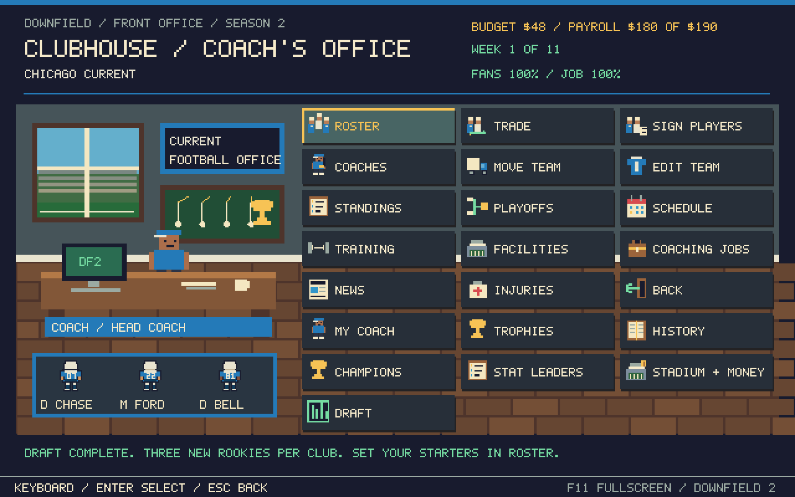
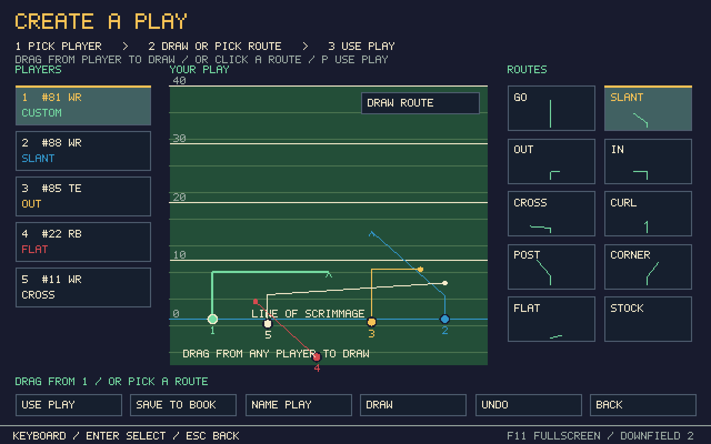
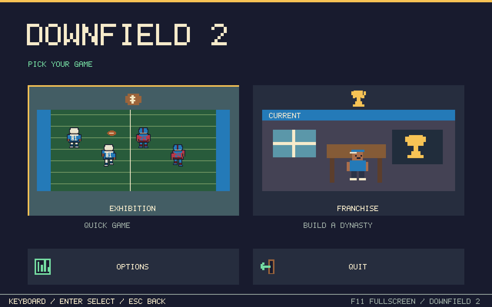
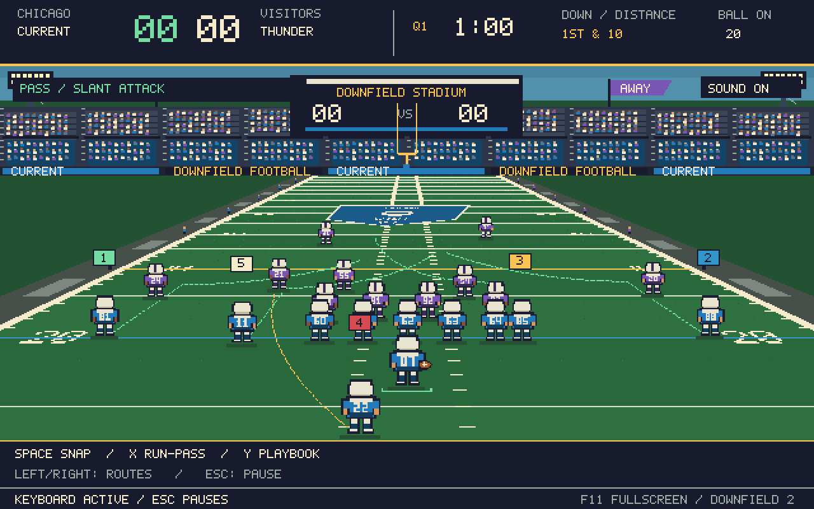

# Downfield 2

A little arcade football game I'm working on. I wanted quick games, Madden-style buttons, and a team you can build over a season. It's still a work in progress.

## Just want to play?

**Downloads are paused while a reported Windows Defender warning is investigated.** The reported name is `Trojan:Win32/Ulthar.A!ml`. Keep flagged copies quarantined and hold off on sharing or running them.

The local files match the published build. A local Defender custom scan returned no threats, but that does not settle the reported detection. We need the affected file and Microsoft's determination before calling it a false positive. [Review notes and file hashes](docs/SECURITY-REVIEW.md).

The installer, portable EXE and Windows ZIP have been withdrawn from the current branch during review. Source, game documentation and save files remain available. The existing game targets **64-bit Windows 10/11** and uses Windows' .NET Framework.

## New in this update

- Defense update: safeties stay deep, help against fast receivers and take better tackling angles. Zones carry vertical routes, linebackers watch repeated QB escapes, and the defense adjusts when you keep calling deep passes. Good signings still matter, but one go route should take more work.
- Real crowd recordings, quieter ambience and bigger reactions. Volume controls are in **Pause > Settings**.
- Draw routes by dragging from a receiver in **Create a Play**. On Xbox, press **X** to draw, then hold **A** while moving the left stick. Presets still work.
- An onside alternative: **4th-and-13 from your own 30**. Gain 13 to keep it. Fall short and the opponent takes over. Any quarter, any score. The first attempt each game explains the rule.
- Flea-flickers: the RB can pitch back to the QB, who can throw if the ball stayed behind the line and no forward pass has been used.
- Bigger airborne hits, hard landings, turf bursts and more injuries. Real reserves come in wearing their own numbers. No healthy backup means an empty spot.
- A pixel office, clearer menu pictures, player portraits and dollar prices.
- **Stadium + Money** has food and parking prices. Games have running costs; byes still have bills. Expensive prices can hurt attendance and fan support. Bad results, unhappy fans or serious debt can get you fired. Your coach record follows you to your next job.
- Clear MVP and Offensive Player of the Year races, plus passing, rushing and receiving tables. All 12 clubs compete using player stats and ratings.

## Modes and team features

The first screen now has **Exhibition** for a quick game and **Franchise** for your team. The clubhouse uses shorter labels, icons and little pixel players.

- Name your coach and change his pixel appearance.
- Keep your coach record when you change teams.
- Follow past seasons and champions, and collect championship, MVP and OPOTY trophies.
- Call from 24 plays, including read option, jet sweep, toss, mesh and wheel routes.
- Create a play: pick a receiver, choose a route, then press Use Play. Save it or draw your own routes if you want.
- Nudge the left stick as you release a throw to lead your receiver a little.
- Hear stadium crowds, touchdown cheers, first-down applause, big-hit reactions, whistles and tackle sounds. Pause > Settings has the sound mixer.

Halftime now resets the field and possession. You receive to start the game; the opponent receives at its own 20 after halftime. Playoff games have their own scoreboard label and bowl art. Speed, hands and OVR make more of a difference, and receivers block once your QB crosses the line.

## What the game is

You play offense and try to put points on the board. Pick a run or pass, read what's open, and use your receivers' buttons to throw. The other team's drives are simulated. Quarters are one minute, so a game doesn't take long.

There are jukes, spins, jumps, trucks, dives, fumbles, interceptions and field goals. The defense changes coverages, disguises some of them and mixes in occasional two-man stunts. Bigger hits can knock someone down or cause an injury.

It's meant to be fun and arcadey.

## Build your team

The Clubhouse is your little pixel-art office. From there you can:

- Look through your roster and choose who starts.
- Sign players from 70 to 99 OVR.
- Trade with the other clubs.
- Renew contracts, release reserves and work around the salary cap.
- Hire offensive, defensive and conditioning coaches.
- Train players and upgrade facilities.
- Change your mascot and colors, or move the team to a different city.
- Check injuries, scout other rosters, follow the standings and see the playoff picture.

New signings start on the bench. Go to **Franchise > Clubhouse > Roster**, select the player, and choose his starting spot.

The league has **12 teams**, including **New Orleans**. You play everyone once over 11 weeks. The top six make the playoffs, the top two get a bye, and the winners work their way to the championship. You can keep going into another season.

## Xbox controls

| What you want to do | Button |
|---|---|
| Move | Left stick |
| Sprint | RT |
| Snap | A |
| Throw | A, X, Y, B or RB over the receiver |
| Lob / bullet | Tap the receiver button / hold it and release |
| Small pass placement at release | Left stick, up to about 2 yards |
| Extra manual pass lead | Right stick |
| Throw away behind the line | Click right stick |
| Quick mute | View button, or click the sound button |
| Juke with the ball | Right stick left or right |
| Truck | Right stick up |
| Spin | Right stick down or B |
| Jump once you're past the line | Y |
| Dive | X |
| Handoff / backward pitch | LB |
| Playbook before the snap | Y |
| Pause | Menu |

Y changes with what you're doing: playbook before the snap, receiver button while passing, jump when you're carrying past the line. Right-stick up trucks. It doesn't jump anymore.

On **Read Option**, snap and choose: LB gives to the back, or keep the ball and run. Once you cross the line, LB becomes a backward pitch.

In menus, use the D-pad or left stick, A to select and B to go back. LB/RB jumps a page in long lists.

## Keyboard controls

WASD moves, Shift sprints and Space snaps. Numbers 1–5 throw to the matching receiver. Tap for a lob or hold and release for a bullet.

With the ball, left/right arrows juke, up trucks and down spins. J jumps, F dives, E also spins and Q pitches backward. Y opens the playbook before the snap. Escape pauses.

T throws away while passing. M mutes. Menus use arrows, Enter and Escape. Q/R jumps a page. You can also click menu cards. WASD nudges pass placement as you release the number key.

## Want to sim?

- **Schedule > Sim Next Game** skips your next fixture and advances the league.
- **Pause > Sim Rest of Game** finishes the game you're already in.
- **Playbook > Simulate Drive** finishes your possession before the snap.

Franchise results count toward the season. Exhibition games leave your franchise alone. Your team saves automatically, but a live game can't be resumed after closing it. Leaving an unfinished league game counts as a 0–21 forfeit.

The [full guide](docs/FRANCHISE-GUIDE.md) covers trades, contracts, training, injuries, playoff rules and saves.

## How it's made, without the computer-science lecture

It's written in **C#** and runs as a normal Windows app. It doesn't use Unity or Unreal.

The code moves the players, checks catches and tackles, keeps score, and decides what the defense does. Another part draws the field and the little pixel players. The office and menus are drawn the same way.

The art is made by the game from colored shapes. The sounds are short waveforms made in code, with no downloaded recordings. The football, uniforms and menus don't need a separate pile of image files, which is why the game can run from one exe.

The team and season live in a save file on your PC. They aren't stored on a server. The installer copies the game and instructions into your Windows user folder and puts a working exe on your desktop.

If you're looking around the source:

- **Simulation.cs, Mechanics.cs:** the football rules, movement and game flow.
- **Defense.cs, LinePlay.cs:** coverage, pursuit, blocking and stunts.
- **Impacts.cs:** trucks, knockback and falling.
- **Franchise.cs, Career.cs, ClubBusiness.cs:** teams, contracts, costs, fans, jobs, history and awards.
- **GameForm.cs, FranchiseUI.cs, BetaUI.cs:** what you see and how the menus work.
- **DrawnPlay.cs, PlayDesigner.cs:** drawing routes and running them on the field.
- **GameAudio.cs, CrowdRecordings.cs, FootballSounds.cs, StadiumMixer.cs, WaveOutput.cs:** recorded crowds and mixed sound effects.
- **Input.cs:** keyboard and Xbox input.
- **PixelArt.cs:** the pixel players and lettering.
- **installer/Installer.cs:** the setup program.

## If you want to build it yourself

On Windows, open PowerShell in the repo folder and run:

    powershell -ExecutionPolicy Bypass -File .\build.ps1

That makes the game in **build/Downfield.exe** and runs the game tests. To check the menus too:

    .\build\Downfield.Tests.exe --ui-test

To rebuild the installer after building the game:

    powershell -ExecutionPolicy Bypass -File .\build-installer.ps1

The installer script also tests a fresh install and reinstall in a temporary folder.

## A few things to know

This is single-player and offense-only right now. There's no playable defense, online multiplayer or save-in-the-middle-of-a-game feature. A tied playoff game uses simulated overtime.

The automated tests cover the game rules, league, saves, menus and the installer. That doesn't mean every controller or every possible play has been tested by a person. If something feels off, [open an issue](https://github.com/dstaggs-15/downfieldftbl/issues) and tell me what happened.

The source, original artwork and generated effects are under the [MIT license](LICENSE.txt). Recorded crowds are CC0; their [creators and sources are here](audio/CREDITS.md). Retro Bowl is a separate game; its code and assets aren't included here.
